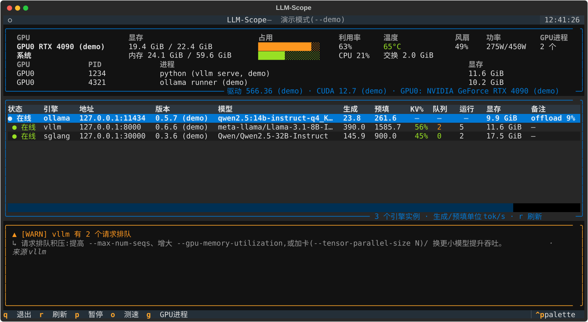
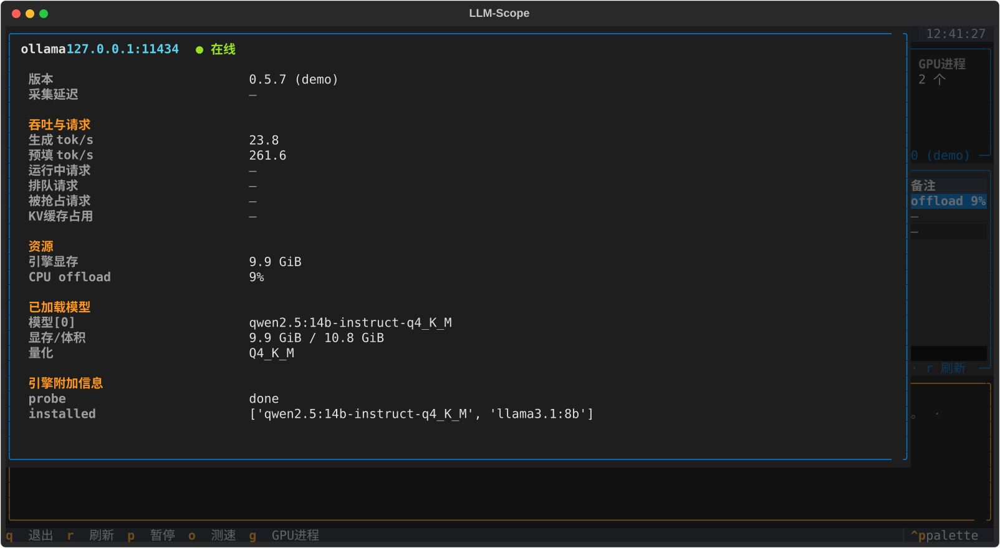

# LLM-Scope

轻量、**零配置**的本地 LLM 多引擎监控工具。面向单机 Windows / Linux 玩家:
自动发现本机运行的 **Ollama / vLLM / SGLang**,在一个 htop 风格的终端界面里
统一展示硬件指标与推理指标,并给出基础的诊断与优化建议。

```
┌─ 硬件概览 ──────────────────────────────────────────────┐
│ GPU 显存条 / 利用率 / 温度 / 风扇 / 功率 / 系统内存与 CPU │
├─ 引擎列表 ──────────────────────────────────────────────┤
│ 状态·版本·模型·生成 tok/s·预填 tok/s·KV缓存·队列·显存    │
├─ 诊断提示 ──────────────────────────────────────────────┤
│ 显存压力 / 排队积压 / CPU offload / 高温 → 具体优化建议   │
└─────────────────────────────────────────────────────────┘
```





## 特性

- **零配置自动发现**:默认端口探测(11434 / 8000 / 30000)+ 进程名 / 命令行识别
  (可发现自定义端口),所有候选端口经指纹端点确认,不误判其它服务——
  包括 Ollama 桌面版 GUI 端口和其内嵌 llama.cpp 引擎端口
- **统一指标层**:vLLM / SGLang 解析 Prometheus `/metrics`(吞吐差分、KV 缓存、
  队列、抢占,原文缓存在详情页可看);Ollama 读取 `/api/tags`、`/api/ps`,
  并用**后台微探针**(8 token 的流式请求,默认 30s 一次)估算实时生成速度
- **硬件监控**:pynvml(NVIDIA 显存 / 利用率 / 温度 / 功率 / 显存进程)+
  psutil(CPU / 内存 / 交换);显卡名自动提炼成 `RTX 4050` 这类简称,
  完整名称在面板副标题备查;没有 NVIDIA 环境时优雅降级
- **GPU 进程明细**:按 `g` 展开,逐进程列出显存占用(按占用降序)
- **引擎详情页**:引擎表格里按回车进入,查看该引擎的全部字段与
  `/metrics` 原始输出(按 `m` 切换原文)
- **诊断建议**:显存占比过高、KV 缓存吃紧、请求排队、生成速度过低、
  CPU offload、高温、内存压力等规则,直接给出对应的启动参数 / 环境变量建议
- **两种出口**:交互 TUI(textual)+ 单次文本报告(`--once`,便于脚本 / CI)

## 安装

需要 Python 3.10+;NVIDIA 显卡监控需要已装驱动的 NVIDIA GPU。

```bash
# 1) 获取代码
git clone https://github.com/<你的用户名>/LLM-Scope.git
cd LLM-Scope

# 2) 创建虚拟环境
# Windows (PowerShell)
python -m venv .venv
.venv\Scripts\activate
# Linux / macOS
python3 -m venv .venv
source .venv/bin/activate

# 3) 安装依赖
pip install -r requirements.txt
```

## 使用

```bash
python run.py             # 启动 TUI(默认实时监控)
python run.py --demo      # 演示数据,无需 GPU / 引擎,体验完整界面
python run.py --once      # 单次采集,输出文本报告后退出
python run.py --interval 1   # 引擎指标刷新间隔改为 1 秒
python -m llmscope        # 等价入口
```

### 按键

| 键 | 作用 |
|----|------|
| `q` | 退出 |
| `r` | 立即重新发现 + 刷新一轮 |
| `p` | 暂停 / 恢复采集(界面保持可滚动查看) |
| `o` | 开关 Ollama 后台测速探针 |
| `g` | 展开 / 收起 GPU 进程显存明细 |
| `回车` | 进入光标所在引擎的详情页(全部字段 + `/metrics` 原文) |
| `m` | 详情页内:切换显示 `/metrics` 原始输出 |
| `esc` | 详情页内:返回主界面 |

### Ollama 测速探针说明

Ollama 原生 API 不暴露实时吞吐,本工具通过向**已加载**的模型发送一个极小的
流式生成请求(默认 8 token、间隔 30s、温度 0)来估算 token/s。它不会把冷模型
拉进显存;但若你正在跑其它生成任务,探针会排在队列后面,偶尔拉低当轮估值。
按 `o` 可随时关闭。

## 工作原理

```
llmscope/
├── config.py           # 端口 / 刷新间隔 / 诊断阈值(全部可调参数集中于此)
├── models.py           # EngineSnapshot / HardwareSnapshot / Diagnostic 数据模型
├── utils.py            # 字节/速率格式化、GPU 短名提炼
├── discovery.py        # 双通道发现:默认端口 + 进程识别 → 指纹确认
├── manager.py          # 引擎管理器:维护在线列表(带容灾)+ 线程池并行采集
├── diagnostics.py      # 诊断规则(@rule 注册,按严重级排序)
├── demo.py             # --demo 演示数据(正弦曲线驱动,周期越过阈值)
├── collectors/
│   ├── base.py         # BaseEngineCollector 基类 + 注册表说明
│   ├── prometheus.py   # 极简 Prometheus 文本解析(零依赖)
│   ├── vllm.py         # /version /v1/models /metrics + counter 差分
│   ├── sglang.py       # /get_model_info /get_server_info /metrics
│   ├── ollama.py       # /api/* + 流式测速探针
│   └── hardware.py     # pynvml + psutil
└── ui/
    ├── widgets.py      # 纯渲染函数(TUI 与 --once 报告共用)
    ├── screens.py      # 引擎详情页(回车进入的模态浮层)
    └── app.py          # Textual App:三栏布局 + 定时任务(线程池采集)
```

发现层把"端口上是什么"交给**指纹**判定:SGLang 认 `/get_model_info`,
vLLM 认 `/version` + `/v1/models`(并排除 SGLang / Ollama 特征),
Ollama 认 `/api/version`。一个端口只会归属一个引擎,注册顺序即优先级。

## 各引擎注意事项

- **vLLM / SGLang**:原生为 Linux 服务;Windows 用户通常跑在 WSL 里,
  端口转发后本工具仍可通过默认端口发现(进程识别仅覆盖本机进程)。
- 若 vLLM 启用了 `--api-key`,`/metrics` 会 401,界面会提示;
  本机监控场景建议不设 key 或放行本机。
- Ollama 版本需支持 `/api/ps`(2024 年后的版本均支持)。

## 扩展:接入新引擎

以 LM Studio 为例,三步接入:

```python
# llmscope/collectors/lmstudio.py
from .. import models
from . import register
from .base import BaseEngineCollector, get_json
from ..models import EngineSnapshot

@register
class LmStudioCollector(BaseEngineCollector):
    engine_name = models.OLLAMA + "_compat"      # 任意唯一标识
    default_ports = (1234,)
    process_keywords = ("lm-studio", "lm studio")

    @classmethod
    def fingerprint(cls, host, port):
        v = get_json(f"http://{host}:{port}/v1/models", timeout=2)
        if isinstance(v, dict) and v.get("data"):
            return EngineSnapshot(engine=cls.engine_name, host=host, port=port)

    def collect(self, host, port, prev=None):
        ...  # 参考 vllm.py,补全 EngineSnapshot 字段即可
```

然后在 `collectors/__init__.py` 底部加一行导入(注意注册顺序决定指纹优先级),
UI、发现、诊断层自动生效。

## 常见问题

- **没有 NVIDIA GPU?** 硬件面板会显示原因,其余功能正常;
  想看完整效果可用 `--demo`。
- **表格里灰色的"—"是什么意思?** 表示该引擎**不提供**这个指标
  (比如 Ollama 没有 KV 缓存 / 队列 / 运行数的概念),不是采集失败;
  支持这些指标的引擎(vLLM / SGLang)拿到数据后会自动点亮。
- **显卡名为什么变短了?** 面板里显示 `RTX 3050 Laptop` 这类简称,
  完整名称(`NVIDIA GeForce RTX 3050 Laptop GPU`)在硬件面板右下角副标题。
- **`net_connections` 权限报错?** Linux 上查看其它用户进程的监听端口需要
  root;无权限时自动退回"仅默认端口扫描",不影响使用。
- **引擎刚刚重启就消失了?** 管理器有 2 轮容灾(约 20s),加载权重期间的
  无响应不会导致闪烁;超过后才会移除,恢复后自动重新接入。
- **阈值想改?** 全部在 `llmscope/config.py`,有中文注释。

## 测试

```bash
pip install pytest
python -m pytest tests -q
```

测试包含:mock 引擎服务的指纹 / 指标解析单元测试(含 llama.cpp、
Ollama 桌面 GUI 等"高仿服务"的防误判回归)、演示数据管线、无头 TUI
渲染测试(`run_test`)、GPU 短名与详情页交互测试,无需真实 GPU 或引擎。

## License

[MIT](LICENSE)
